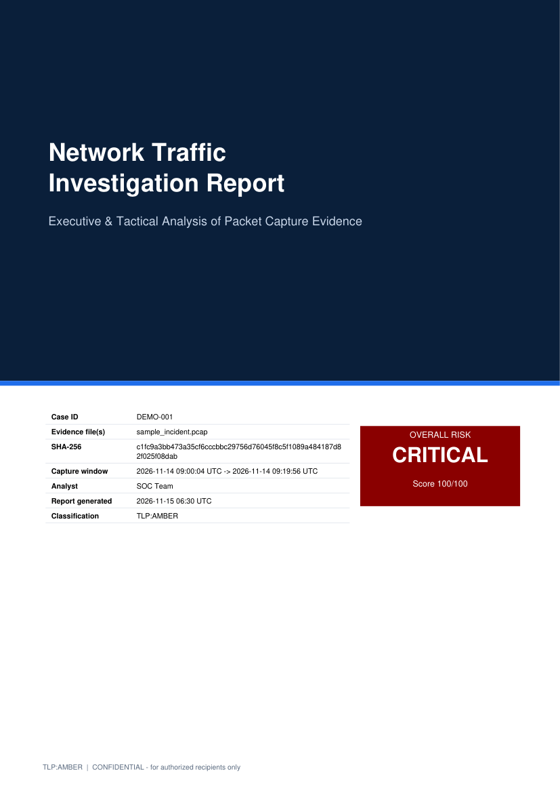
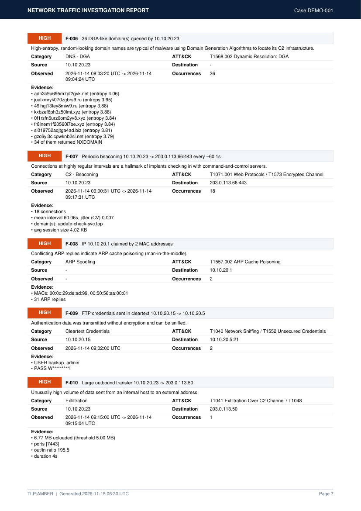
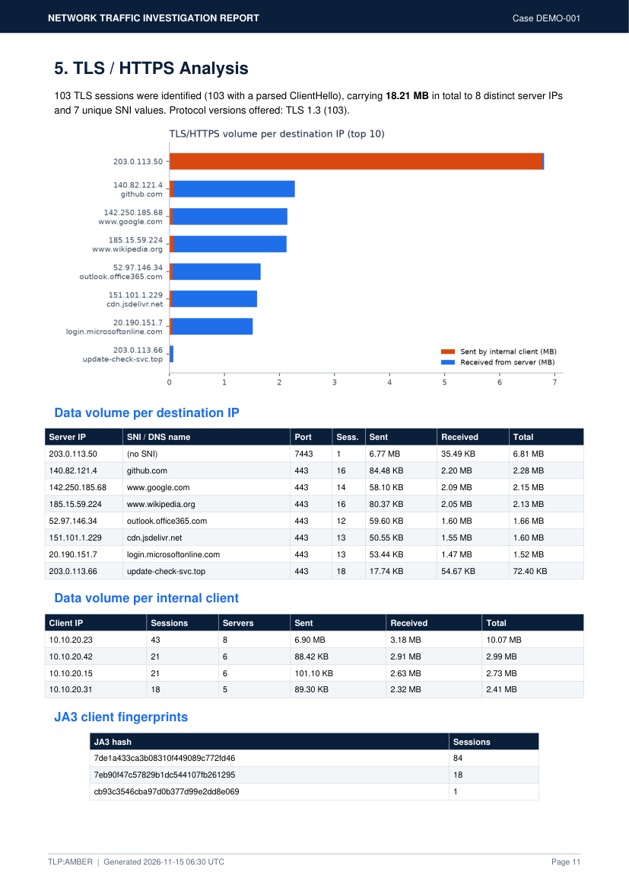

# Network Traffic Investigation (NTI)

أداة تحليل جنائي لملفات PCAP/PCAPNG مكتوبة بـ Python + Scapy. تستخرج مؤشرات DNS وTLS،
تكتشف السلوك الشاذ، وتولّد تقرير PDF (تنفيذي + تكتيكي) مع ملفات IOCs جاهزة لـ SIEM/Firewall.

A PCAP forensics tool that extracts DNS & TLS indicators, detects anomalies, and produces an
executive + tactical PDF report plus SIEM-ready IOC exports.

[](https://github.com/Youssef840/network-traffic-investigation/actions/workflows/ci.yml)


[](LICENSE)


```
PCAP ──► Collector (single pass) ──► Detectors (DNS · TLS · Anomalies · Threat Intel)
                                          │
                       ┌──────────────────┼───────────────────┬──────────────┐
                       ▼                  ▼                   ▼              ▼
                  PDF report        HTML dashboard       STIX 2.1 bundle   CSV / JSON
             (executive+tactical)  (interactive, offline) (MISP/OpenCTI)   (SIEM/Firewall)
```

## 📄 نموذج تقرير (Sample report)

### 🌐 [افتح اللوحة التفاعلية أونلاين ← youssef840.github.io/network-traffic-investigation](https://youssef840.github.io/network-traffic-investigation/)
<sub>تقرير حقيقي من الأداة على ملف PCAP **اصطناعي** (عناوين توثيقية ونطاقات وهمية)، يُعاد توليده تلقائياً مع كل تحديث للكود.</sub>

تقرير كامل تم توليده من ملف الـ PCAP التجريبي: **[DEMO-001_report.pdf](reports/DEMO-001_report.pdf)** (13 صفحة)،
ولوحة HTML تفاعلية: **[DEMO-001_report.html](reports/DEMO-001_report.html)**، وحزمة [STIX 2.1](reports/DEMO-001_stix.json)،
ومعه [IOCs CSV](reports/DEMO-001_iocs.csv) و[Findings CSV](reports/DEMO-001_findings.csv) و[JSON](reports/DEMO-001_results.json).

| الغلاف وتقييم الخطورة | Findings مع MITRE ATT&CK | تحليل TLS |
|---|---|---|
|  |  |  |

---

## المميزات (Features)

| المجال | ما يتم اكتشافه |
|---|---|
| **DNS** | نطاقات DGA (Entropy + نسبة الحروف المتحركة)، DNS Tunneling (عدد النطاقات الفرعية/الطول/TXT)، معدل NXDOMAIN المرتفع، TLDs عالية الخطورة، تجاوز DNS المؤسسي، تطابق مع قوائم Threat Intel |
| **TLS/HTTPS** | استخراج SNI، بصمة JA3، إصدار TLS، **حجم البيانات المرسلة/المستقبلة لكل IP** (خادم وعميل)، TLS بدون SNI، TLS على منافذ غير قياسية، إصدارات TLS قديمة، JA3 خبيثة |
| **Anomalies** | Beaconing (انتظام فترات الاتصال = C2)، تسريب بيانات (حجم/نسبة الرفع)، Port Scan عمودي وأفقي، SYN Flood، منافذ Backdoor (4444/1337/...)، ICMP Tunneling، ARP Spoofing، بيانات اعتماد بنص واضح (FTP/POP3/IMAP/HTTP Basic)، User-Agents مشبوهة وتحميل ملفات تنفيذية |
| **التقارير والتصدير** | PDF تنفيذي وتكتيكي، **لوحة HTML تفاعلية** (فلترة وترتيب ونسخ الـ IOCs بضغطة)، **STIX 2.1** للاستيراد في MISP/OpenCTI، وملفات CSV/JSON |
| **تفاصيل PDF** | غلاف + تقييم خطورة، ملخص تنفيذي تلقائي، جدول IOCs (defanged)، Findings مفصلة مع MITRE ATT&CK، تحليل DNS، تحليل TLS بالرسوم، نظرة عامة على الحركة، توصيات، منهجية |

## هيكل المشروع

```
Network-Traffic-Investigation/
├── analyze.py                 # غلاف للتوافق (يستدعي nti.cli)
├── pyproject.toml             # تعريف الحزمة + أمر nti + إعدادات ruff/pytest
├── Dockerfile · Makefile · .pre-commit-config.yaml
├── nti/
│   ├── cli.py                 # واجهة سطر الأوامر
│   ├── report_html.py         # لوحة HTML تفاعلية (بدون أي ملفات خارجية)
│   ├── stix.py                # تصدير STIX 2.1
│   ├── collector.py           # قراءة الحزم بتمريرة واحدة وبناء Flows/DNS/TLS/HTTP/ARP/ICMP
│   ├── tls.py                 # تحليل ClientHello: SNI + JA3
│   ├── detectors.py           # محرك الاكتشاف + IOCs + الإحصائيات + تقييم الخطورة
│   ├── report_pdf.py          # توليد تقرير PDF (ReportLab + Matplotlib)
│   ├── config.py              # العتبات، القوائم، MITRE، تحميل Threat Intel
│   └── utils.py
├── iocs/                      # قوائم Threat Intel (domains / IPs / JA3)
├── tests/                     # 32 اختبار (pytest) - تغطية 94%
├── tools/generate_sample_pcap.py  # مولّد PCAP تجريبي يحوي 10 سيناريوهات هجوم
├── .github/                   # CI (Linux/Windows/macOS + Docker)، قوالب Issues/PR، Dependabot
├── config.example.json        # مثال لتعديل العتبات
└── requirements.txt
```

## خطوات التشغيل (Setup & Run)

**1. المتطلبات:** Python 3.10 أو أحدث.

**2. إنشاء بيئة افتراضية وتثبيت المكتبات**

Windows (PowerShell):
```powershell
cd Network-Traffic-Investigation
python -m venv .venv
.venv\Scripts\Activate.ps1
pip install .            # يضيف الأمر nti   (أو: pip install -r requirements.txt)
```

Linux / macOS:
```bash
cd Network-Traffic-Investigation
python3 -m venv .venv && source .venv/bin/activate
pip install .
```

> قراءة ملفات PCAP لا تحتاج Npcap/libpcap. (تحذير Scapy "No libpcap provider" طبيعي ويمكن تجاهله.)

**3. توليد ملف PCAP تجريبي** (الملف غير موجود في الـ repo لحجمه؛ التوليد يستغرق ثوانٍ)
```bash
python tools/generate_sample_pcap.py -o samples/sample_incident.pcap
```

**4. تحليل الملف وتوليد التقرير**
```bash
nti samples/sample_incident.pcap --case-id IR-2026-001 --analyst "SOC Team"
# أو: python -m nti ...   أو: python analyze.py ...
```

**5. المخرجات** في مجلد `reports/`:

| الملف | المحتوى |
|---|---|
| `<case>_report.pdf` | التقرير التنفيذي والتكتيكي |
| `<case>_report.html` | لوحة تفاعلية تفتح في أي متصفح (تعمل بدون إنترنت) |
| `<case>_stix.json` | حزمة STIX 2.1 للـ IOCs (MISP / OpenCTI / TIP) |
| `<case>_iocs.csv` | قائمة IOCs (type, value, severity, hits, ...) |
| `<case>_findings.csv` | جميع النتائج |
| `<case>_results.json` | كل النتائج والإحصائيات بصيغة JSON |

## خيارات سطر الأوامر

```
nti PCAP [PCAP ...] [options]

  -o, --output DIR        مجلد المخرجات (افتراضي: reports)
  --case-id ID            رقم القضية
  --analyst NAME          اسم المحلل في التقرير
  --tlp {CLEAR,GREEN,AMBER,RED}
  --internal CIDR ...     نطاقات الشبكة الداخلية (افتراضي RFC1918)
  --intel-dir DIR         مجلد قوائم Threat Intel (افتراضي iocs/)
  --config FILE.json      تعديل عتبات الاكتشاف (انظر config.example.json)
  --exfil-mb N            حد الرفع (MB) لتنبيه تسريب البيانات (افتراضي 5)
  --max-packets N         إيقاف بعد N حزمة لكل ملف
  --no-pdf / --no-html / --no-stix   تخطي نوع مخرجات معيّن
  --version               عرض الإصدار
  -q, --quiet             مخرجات مختصرة
```

أمثلة:
```bash
# عدة ملفات + شبكة داخلية مخصصة
nti day1.pcapng day2.pcapng --internal 10.50.0.0/16 172.20.0.0/14

# عتبات مخصصة
nti capture.pcap --config config.example.json --exfil-mb 50
```

## Docker

```bash
docker build -t nti .
docker run --rm -v "$PWD/cases:/data" nti /data/capture.pcap -o /data/reports --case-id IR-001
```
الصورة تعمل بمستخدم غير root، ومجلد `iocs/` مضمّن فيها.

## التطوير والاختبارات (Development)

```bash
pip install -e ".[dev]"   # pytest + ruff + pre-commit
pre-commit install
make test                 # أو: pytest --cov
make lint
make demo                 # إعادة توليد تقرير DEMO-001
```

الاختبار الشامل (`tests/test_end_to_end.py`) يولّد الـ PCAP التجريبي ويتحقق أن **كل سيناريو هجوم مزروع يتم اكتشافه** وأن كل المخرجات صحيحة.
راجع [CONTRIBUTING.md](CONTRIBUTING.md) لإضافة Detector جديد، و[SECURITY.md](SECURITY.md) للإبلاغ عن ثغرات، و[CHANGELOG.md](CHANGELOG.md) لسجل الإصدارات.

## Threat Intelligence

ضع المؤشرات في مجلد `iocs/` (سطر لكل مؤشر، `#` للتعليقات):

- `malicious_domains.txt` – النطاقات (تطابق النطاقات الفرعية تلقائياً)
- `malicious_ips.txt` – عناوين IP
- `ja3_blocklist.txt` – `hash,label`

مصادر مقترحة: abuse.ch (ThreatFox, URLhaus, Feodo Tracker, SSLBL JA3)، MISP، OpenCTI.

## ملاحظات

- الاكتشافات **إرشادية (heuristic)** ويجب أن يتحقق منها محلل؛ عدّل العتبات حسب بيئتك.
- الحركة المشفرة لا يتم فك تشفيرها؛ تحليل TLS يعتمد على البيانات الوصفية (SNI/JA3/الحجم/التوقيت).
- ملفات PCAP الكبيرة جداً (عدة GB): استخدم `--max-packets` أو قسّم الملف بـ `editcap -c`.
- السيناريوهات في الملف التجريبي اصطناعية وتستخدم عناوين IP التوثيقية (RFC 5737) ونطاقات وهمية.

## الرخصة (License)

[MIT](LICENSE) © 2026 Youssef Hussein
